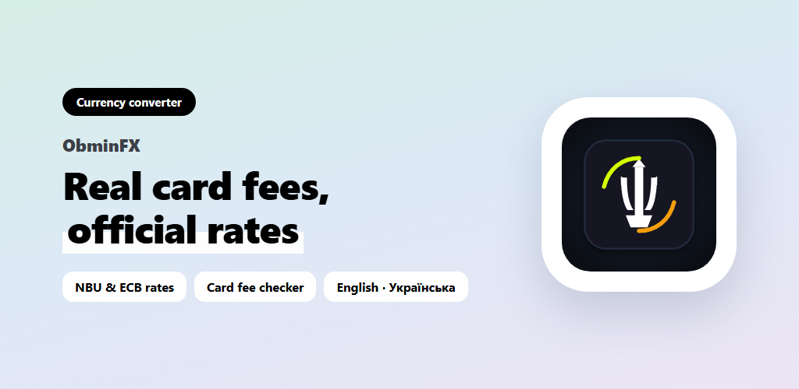
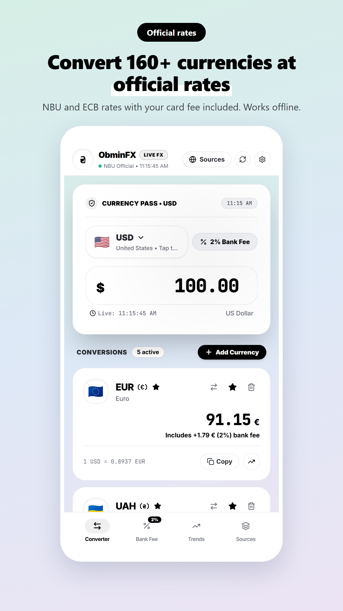
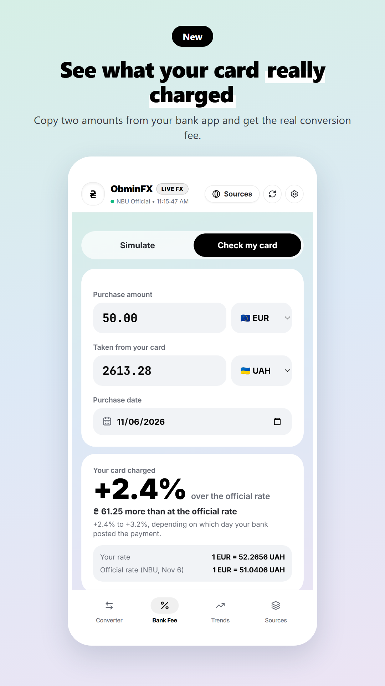
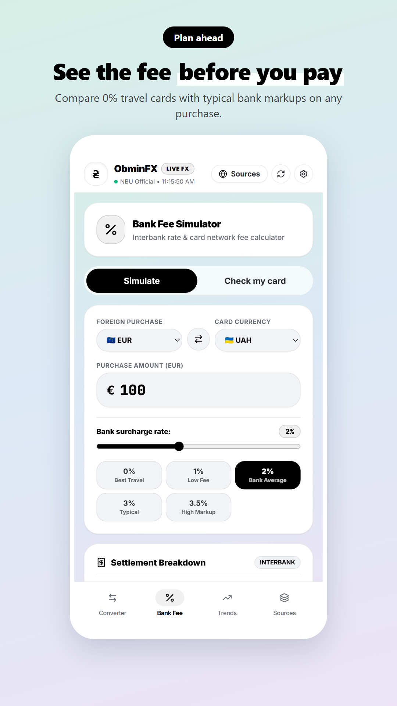
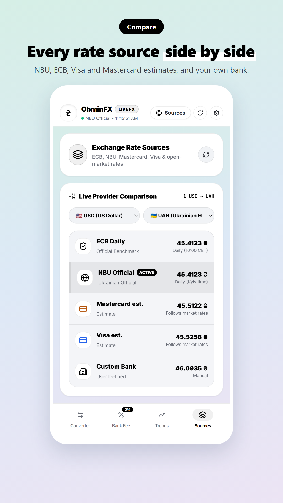
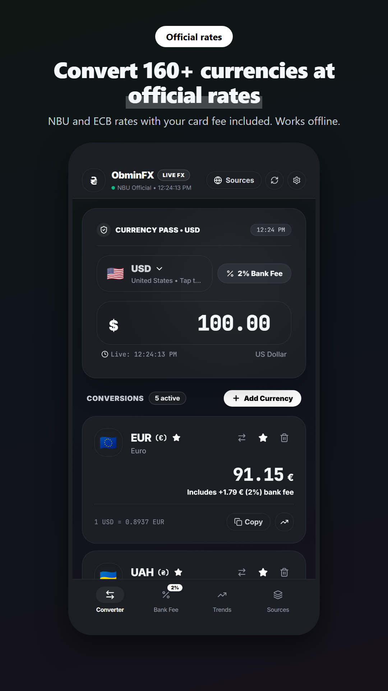
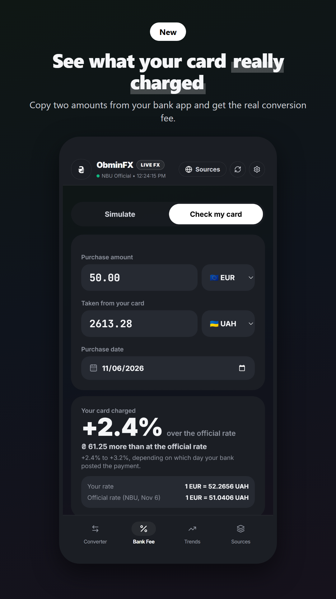
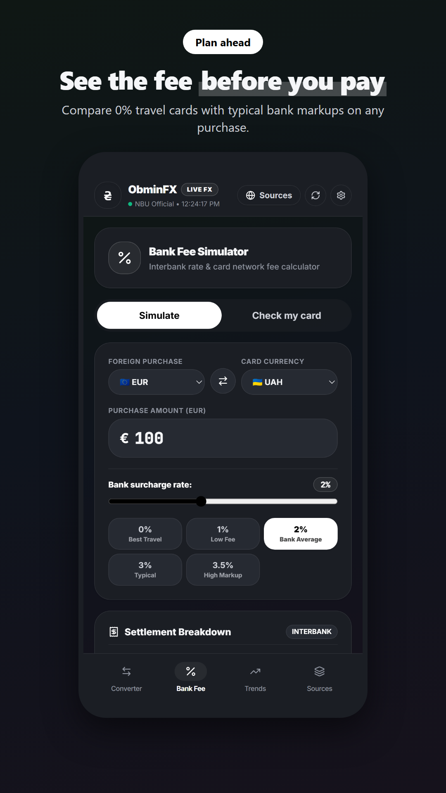
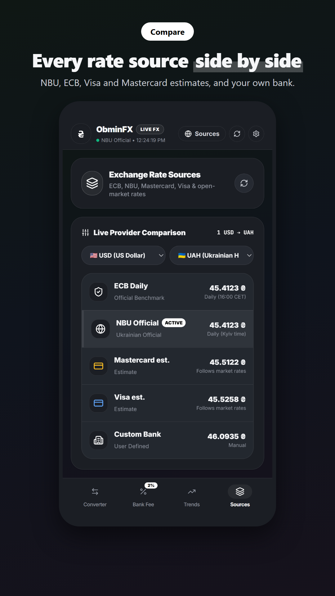

# ObminFX — Currency Converter & Bank Fee Calculator

<p align="center">
  
</p>

<p align="center">
  <a href="https://github.com/oleh11/obminfx/releases/latest"></a>
  <a href="https://github.com/oleh11/obminfx/releases"></a>
  <a href="https://github.com/oleh11/obminfx/blob/main/LICENSE"></a>
  <a href="https://react.dev/"></a>
  <a href="https://capacitorjs.com/"></a>
  <a href="https://tailwindcss.com/"></a>
</p>

---

> **Obmin** (*обмін*) means **"exchange"** in Ukrainian 🇺🇦.  
> **ObminFX** is a modern, transparent currency converter and bank processing fee simulator designed for Android and the web.

---

## 📱 App Preview

<p align="center">
  
  
  
  
</p>

<p align="center"><b>Dark theme</b> (follows your phone, or pick it in Settings)</p>

<p align="center">
  
  
  
  
</p>

---

## 📥 Download & Install

| Where | How |
| :--- | :--- |
| **Direct APK** | [**Download the latest ObminFX.apk**](https://github.com/oleh11/obminfx/releases/latest/download/ObminFX.apk) |
| **Obtainium** (auto-updates from GitHub) | [**Add to Obtainium**](https://apps.obtainium.imranr.dev/redirect?r=obtainium://add/https://github.com/oleh11/obminfx) |
| **Google Play** | Launching soon. **Help us get there:** join the [tester group](https://groups.google.com/g/obminfx-testers), then [opt in to the beta](https://play.google.com/apps/testing/com.obminfx.app). |
| **F-Droid** | [Requested](https://gitlab.com/fdroid/rfp/-/work_items/4749), coming soon |

> **Sideloading:** if you install the APK directly, allow *"Install from this source"* when Android asks.

---

## ✨ Key Features

### 🔄 Dynamic Default Currency Switcher
- **One-Tap Base Selector:** Tap the primary currency badge on the main screen to open the currency catalog and select any base currency.
- **Quick Card Swap (`⇄`):** Tap the `⇄` button or the flag on any card in your conversions list to instantly promote it to the default base currency.
- **Smart Preservation:** When switching base currencies, your previous base currency automatically moves into the active conversions list so you never lose track of it.

### ⭐ Favorites Pinning & Alphabetical Sorting
- **Pin to Top:** Star (⭐) any currency to keep it pinned at the very top of your watchlist.
- **Alphabetical Catalog (A &rarr; Z):** Over 160+ ISO world currencies, commodities (Gold, Silver), and crypto (BTC, ETH, SOL) alphabetized for effortless discovery.

### 🏛️ Official Central Bank & Market Rates
- **Official Benchmarks:** Direct live rates from the **European Central Bank (ECB)** and **National Bank of Ukraine (NBU)**.
- **Market & Card Networks:** Open-market mid-rates (open.er-api.com), plus Mastercard and Visa *estimates* (mid-rate + a typical 0.22% / 0.25% network spread — not the networks' published rates).
- **Crypto & Metals:** BTC, ETH, SOL and USDT from CoinGecko; gold, silver, platinum and palladium from gold-api.com.
- **Zero Commercial Bank Bloat:** Pure, transparent interbank exchange rates with no hidden retail markups.

### 🧾 Check My Card
- **What did my card really cost?** Enter the purchase amount and the amount your bank took, straight from your bank app. ObminFX compares the rate you got with the official rate that day (NBU for hryvnia, otherwise ECB) and shows the real conversion fee in percent and money.
- **Honest ranges:** banks often post a payment a few days later, so you also see the range across those days, plus hints for double conversion (EUR → USD → UAH) and mistyped amounts.
- **One tap to reuse:** save the result as your card's fee and every conversion uses it.

### 💳 Smart Bank Fee & Surcharge Simulator
- **Cardholder Fee Modeling:** Real-time simulation of foreign transaction fees (0% to 3.5%+) charged by credit and debit card issuers.
- **Interbank Settlement Breakdown:** Visual breakdown showing wholesale conversion amount vs. bank processing surcharge.

### 🎨 Light and Dark Themes
- **Light:** soft pastel background, white cards and bold black type.
- **Dark:** the same layout on deep tinted greys. Follows your phone's setting, or choose one in Settings.
- **English and Ukrainian** interface, following your phone's language.

---

## 🏗️ Tech Stack

- **Framework:** React 18 with TypeScript
- **Styling:** Tailwind CSS with custom Diia-inspired squircle design tokens
- **Icons:** Lucide React
- **Charts:** Recharts for historical rate trend visualization
- **Native Bridge:** Capacitor 8 with native Android Java bridge (`com.obminfx.app`)
- **Build Tool:** Vite

---

## 💻 Getting Started (Development)

### Prerequisites
- Node.js 18+
- Android Studio (for native Android builds)
- JDK 21

```bash
# 1. Clone the repository
git clone https://github.com/oleh11/obminfx.git
cd obminfx

# 2. Install dependencies
npm install

# 3. Start local development server
npm run dev

# 4. Build web production bundle
npm run build

# 5. Sync web assets to native Android
npx cap sync android

# 6. Open in Android Studio
npx cap open android
```

### 📦 Building Android Release (.aab & .apk)
```powershell
cd android
$env:JAVA_HOME="C:\Users\oleha\.jdks\jbr-21.0.11"
.\gradlew.bat bundleRelease assembleRelease
```

---

## 📄 License

Distributed under the **MIT License**. See [`LICENSE`](LICENSE) for more information.