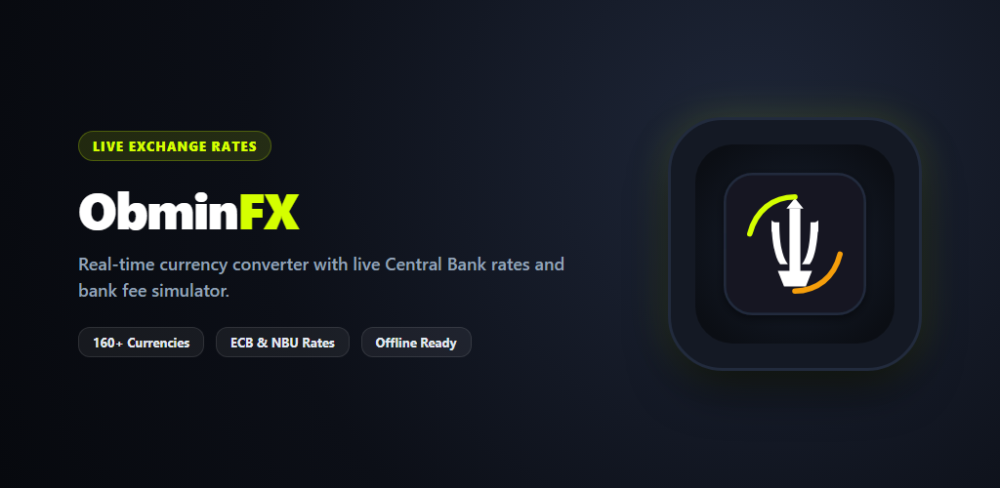
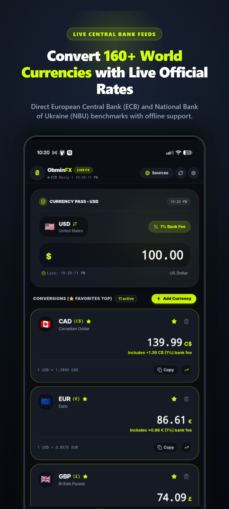
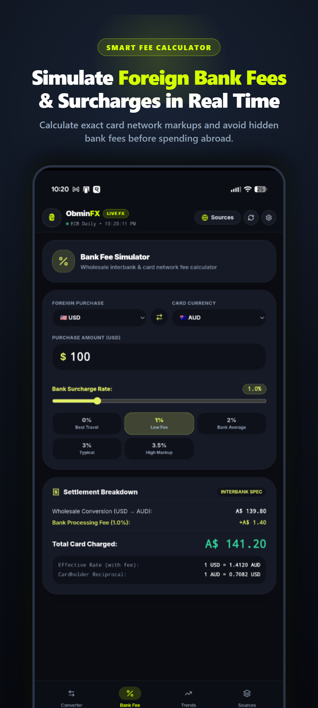

# ObminFX — Currency Converter & Bank Fee Calculator

<p align="center">
  
</p>

<p align="center">
  <a href="https://github.com/oleh11/obminfx/releases/latest"></a>
  <a href="https://github.com/oleh11/obminfx/blob/main/LICENSE"></a>
  <a href="https://react.dev/"></a>
  <a href="https://capacitorjs.com/"></a>
  <a href="https://tailwindcss.com/"></a>
</p>

---

> **Obmin** (*обмін*) means **"exchange"** in Ukrainian 🇺🇦.  
> **ObminFX** is a modern, transparent currency converter and bank processing fee simulator designed for Android and the web.

---

## 📱 App Preview

<p align="center">
  
  &nbsp;
  
</p>

---

## 📥 Download & Install

| Distribution | Format | Link |
| :--- | :--- | :--- |
| **Direct APK** | `.apk` (v2.0.0) | [**Download ObminFX Release APK**](https://github.com/oleh11/obminfx/releases/download/v2.0.0/app-release.apk) |
| **Play Store Bundle** | `.aab` (Production) | Built with package `com.obminfx.app` & signed with RSA-2048 key |

> **Android Sideloading Note:** If downloading the APK directly, enable *"Install from unknown sources"* or *"Install from this source"* in your Android Settings.

---

## ✨ Key Features

### 🔄 Dynamic Default Currency Switcher
- **One-Tap Base Selector:** Tap the primary currency badge on the main screen to open the currency catalog and select any base currency.
- **Quick Card Swap (`⇄`):** Tap the `⇄` button or the flag on any card in your conversions list to instantly promote it to the default base currency.
- **Smart Preservation:** When switching base currencies, your previous base currency automatically moves into the active conversions list so you never lose track of it.

### ⭐ Favorites Pinning & Alphabetical Sorting
- **Pin to Top:** Star (⭐) any currency to keep it pinned at the very top of your watchlist.
- **Alphabetical Catalog (A &rarr; Z):** Over 160+ ISO world currencies, commodities (Gold, Silver), and crypto (BTC, ETH, SOL) alphabetized for effortless discovery.

### 🏛️ Official Central Bank & Market Rates
- **Official Benchmarks:** Direct live rates from the **European Central Bank (ECB)** and **National Bank of Ukraine (NBU)**.
- **Market & Card Networks:** Real-time data from global open markets, Mastercard FX benchmarks, and Visa FX benchmarks.
- **Zero Commercial Bank Bloat:** Pure, transparent interbank exchange rates with no hidden retail markups.

### 💳 Smart Bank Fee & Surcharge Simulator
- **Cardholder Fee Modeling:** Real-time simulation of foreign transaction fees (0% to 3.5%+) charged by credit and debit card issuers.
- **Interbank Settlement Breakdown:** Visual breakdown showing wholesale conversion amount vs. bank processing surcharge.

### 🎨 Diia-Inspired Tactile UI
- **Obsidian Dark Surfaces:** Elegant matte black and charcoal backgrounds (`#0B0E14`, `#161A24`).
- **Tactile Squircles:** Deep `rounded-[32px]` card geometry with soft borders and ambient glowing accents.
- **Electric Neon Accents:** High-legibility Diia-inspired neon lime (`#D4FF00`) and amber gold (`#F59E0B`).

### 🛠️ Data Storage Inspector & Debug Telemetry
- Dedicated data inspector tab showing live cache state, payload sizes, timestamp metrics, and full JSON export/purge tools.

---

## 🏗️ Tech Stack

- **Framework:** React 18 with TypeScript
- **Styling:** Tailwind CSS with custom Diia-inspired squircle design tokens
- **Icons:** Lucide React
- **Charts:** Recharts for historical rate trend visualization
- **Native Bridge:** Capacitor 8 with native Android Java bridge (`com.obminfx.app`)
- **Build Tool:** Vite

---

## 💻 Getting Started (Development)

### Prerequisites
- Node.js 18+
- Android Studio (for native Android builds)
- JDK 21

```bash
# 1. Clone the repository
git clone https://github.com/oleh11/obminfx.git
cd obminfx

# 2. Install dependencies
npm install

# 3. Start local development server
npm run dev

# 4. Build web production bundle
npm run build

# 5. Sync web assets to native Android
npx cap sync android

# 6. Open in Android Studio
npx cap open android
```

### 📦 Building Android Release (.aab & .apk)
```powershell
cd android
$env:JAVA_HOME="C:\Users\oleha\.jdks\jbr-21.0.11"
.\gradlew.bat bundleRelease assembleRelease
```

---

## 📄 License

Distributed under the **MIT License**. See [`LICENSE`](LICENSE) for more information.